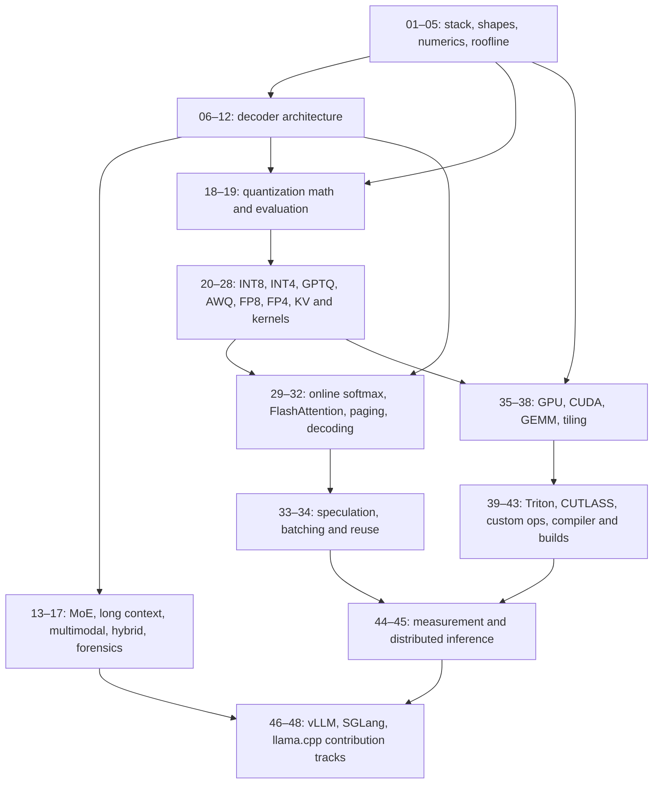

# Concept and Dependency Map

The curriculum has four interlocking strands:

- **Model semantics:** what computation must remain equivalent.
- **Numerics and algorithms:** where approximation or reordering is allowed.
- **GPU/compiler systems:** how computation becomes machine work.
- **Serving systems:** how many requests share finite compute and memory.

Optimizations fail when one strand is changed without checking the others.



## The shortest prerequisite chains

### To understand NVFP4 rather than merely run it

```text
03 tensor shapes
 → 04 numerical formats
 → 05 roofline
 → 18 quantization math
 → 19 calibration/evaluation
 → 21 grouped low-bit packing
 → 25 FP8
 → 26 microscaling/NVFP4
 → 28 quantized kernel integration
 → 35–40 GPU kernels and CUTLASS
 → 43 build/JIT/ABI
```

This chain explains scales, group size, error, weight traffic, block-scaled
Tensor Core instructions, kernel dispatch, `sm_120` compilation, and why Ninja
parallelism can kill a build even though GPU memory is sufficient.

### To understand FlashAttention and PagedAttention

```text
03 shapes → 05 roofline → 10 MHA → 12 GQA/KV
 → 29 online softmax/IO → 30 FlashAttention
 → 31 PagedAttention → 34 scheduling and prefix reuse
 → 46 or 47 runtime internals
```

FlashAttention changes how one attention operation moves data. PagedAttention
changes how a serving engine stores and addresses many requests' KV state.
Continuous batching decides which operations run together. They are related but
not interchangeable optimizations.

### To write an upstream GPU operator

```text
03 shapes → 04 numerics → 05 roofline
 → 35 GPU architecture → 36 CUDA
 → 37 GEMM → 38 tiling/fusion
 → 39 Triton and/or 40 CUTLASS
 → 41 custom operators → 42 compiler integration
 → 43 builds/ABI → 44 measurement
 → target runtime module
```

### To add a new model architecture

```text
06–12 decoder core
 → one or more of 13–16 architecture variants
 → 17 model forensics
 → 19 quality evaluation
 → 32 decoding semantics
 → 44 correctness/performance methodology
 → 46, 47, or 48 target runtime
```

## Three levels of understanding

Use these levels to diagnose shallow knowledge.

| Level | Question you should answer | Example for grouped INT4 |
|---|---|---|
| Semantic | What result is intended? | A dequantized linear transformation within a defined error budget |
| Algorithmic | How is it represented and computed? | Codes, scale/zero point, group mapping, packing, accumulation and epilogue |
| Physical | What does the target execute? | Loads, unpack/convert instructions, Tensor Core or SIMT MMA, cache traffic, synchronization |

Production work also needs a fourth level, **operational**: how the engine
dispatches, compiles, caches, profiles, falls back, and behaves under concurrent
requests.

## Concepts to revisit across phases

### Shape

Shapes begin as algebra in Module 03, become model semantics in Modules 06–17,
kernel launch grids in Modules 35–40, compiler guards in Module 42, and
scheduler batches in Module 34.

### Precision

Precision begins as representation and rounding in Module 04, becomes model
quality in Modules 18–27, accumulation and instruction selection in Modules
35–40, and distributed reduction behavior in Module 45.

### Memory

Memory begins as bytes in a roofline estimate, becomes activations and KV cache,
then shared-memory tiles and registers, then cache blocks and distributed
communication. Always name the level: register, shared/SRAM, L1, L2, HBM/VRAM,
host RAM, storage, or network.

### Correctness

Correctness is not one `allclose`:

- operator equivalence across dtype, shape, stride, and edge cases;
- generation equivalence under deterministic decoding;
- distribution or quality preservation under lossy quantization;
- scheduler invariants under cancellation, preemption, and reuse;
- multi-rank agreement and deadlock freedom;
- build and runtime portability across supported architectures.

## Suggested specialization forks after Module 48

### Kernel specialist

Deepen SASS, CuTe layout algebra, warp-specialized pipelines, distributed shared
memory, Tensor Memory Accelerator usage, auto-tuning, and new low-precision
instructions. Contribute to CUTLASS, FlashInfer, Triton, or runtime kernel
libraries.

### Runtime and scheduler specialist

Deepen queueing theory, admission control, disaggregated prefill/decode,
cache-aware routing, fault tolerance, multi-tenant fairness, structured output,
and observability. Contribute to vLLM or SGLang engine layers.

### Model and quantization specialist

Deepen Hessian/error objectives, mixed-precision search, calibration
distribution shift, multimodal quantization, sparse/MoE kernels, and
hardware-aware model design. Contribute quantization methods or model ports.

### Compiler specialist

Deepen tracing and guard systems, MLIR/LLVM, Triton IR, scheduling, pattern
rewrites, code generation, autotuning databases, and dynamic-shape compilation.
Contribute to PyTorch Inductor, Triton, or backend integration.

